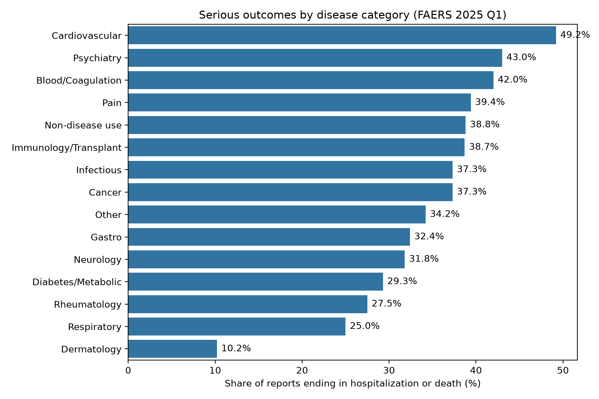

# Serious Outcomes by Disease Category in FDA Adverse Event Reports

Question: Across disease categories, what share of FDA adverse event reports end in hospitalization or death?

Data: FDA FAERS, 2025 Q1 (public quarterly files: INDI and OUTC).

## Result

Highest share of serious outcomes: cardiovascular (49%), psychiatry (43%), blood/coagulation (42%). Lowest: dermatology (10%).

## Method

1. categories.py: loads indications, groups them into 15 disease categories with keyword matching (plus "Other").
2. analysis.py: joins indications with outcomes (LEFT JOIN on report ID); "serious" = hospitalization (HO) or death (DE).
3. chart.py: draws the bar chart.

Tools: Python, pandas, Matplotlib, Seaborn.

## Limitations

- Only one quarter (2025 Q1).
- About 41% of indication rows say "unknown indication" (excluded from the chart).
- Keyword grouping is imperfect; some rows land in "Other".
- This is the share among reported cases, not real-world risk. Older, sicker patients and serious events are more likely to be reported.
- FAERS shows associations, not causes.

## How to run

1. Download FAERS quarterly ASCII files from the FDA website and extract them into this folder.
2. Install: pip install pandas matplotlib seaborn
3. Run python chart.py

## Next steps

- Add more quarters.
- Improve the category keywords.